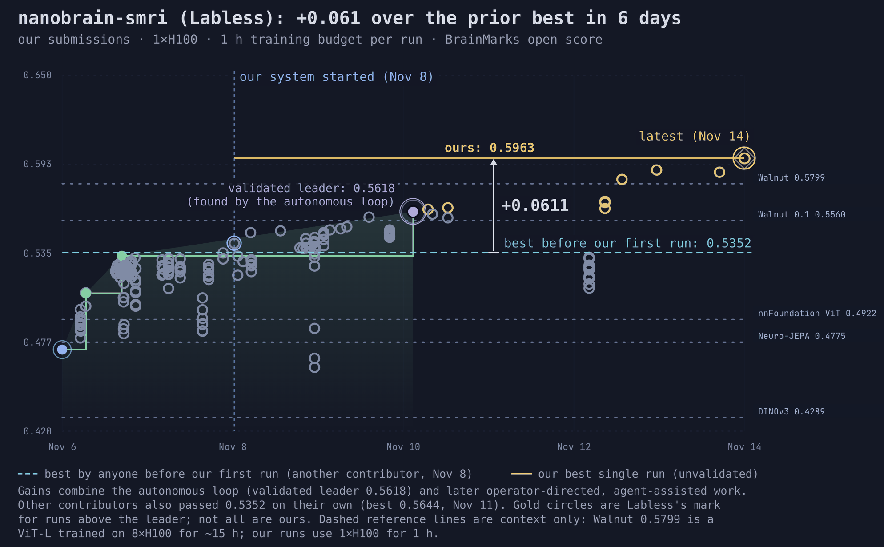
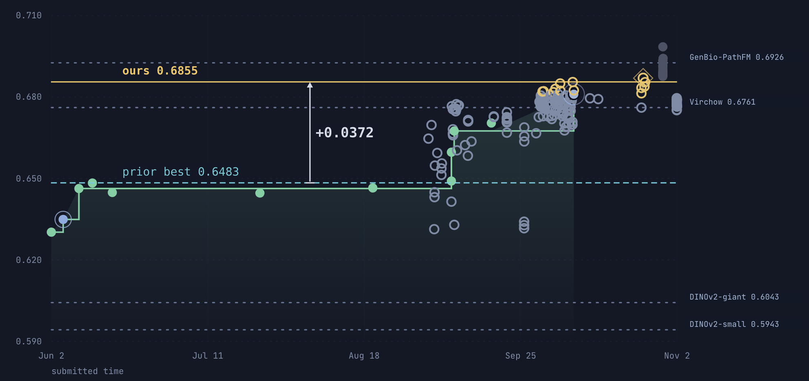

# autoresearch-loop

An LLM-driven autonomous research loop. It proposes, implements, runs and judges ML training experiments on a
SLURM cluster. Decisions about what counts as an improvement are made by statistical guards, never by the
model: paired seeds, empirical-Bayes shrinkage, and confirm stages on fresh seeds.



**nanobrain-smri:** prior best 0.5352 (before our first submission, Nov 8) → ours 0.5963 on Nov 14
([run_sub_df88416804](https://labless.dev/runs/run_sub_df88416804), unvalidated), +0.0611. Other contributors also
improved (best 0.5644); the validated leader is our autonomous-loop run 0.5618
([run_sub_a48ee1990d](https://labless.dev/runs/run_sub_a48ee1990d)).



**nanopath v2:** prior best 0.6483 (best before our first submission, Jun 17) → ours 0.6855 on Oct 8
([run_sub_89113d508d](https://labless.dev/runs/run_sub_89113d508d), unvalidated), +0.0372; much of the Jun–Sep rise
(to 0.6774) came from other contributors. The validated leader is our 0.6810 run
([run_sub_6da523428f](https://labless.dev/runs/run_sub_6da523428f)); another contributor's later unvalidated 0.6870 is
higher than our best.

The division of labour is strict. Plain Python owns all control flow: budgets, seeds, the queue, SLURM
submission, retries, resume, and every number. LLM agents only do what needs judgement. They propose an idea,
edit a git worktree to implement it, smoke-test it, write postmortems, and review the portfolio. No LLM output
ever edits a score, a posterior or a gate.

The worked example is [nanobrain](https://github.com/MedARC-AI/nanobrain). It does 3D masked-autoencoder
pretraining on brain MRI under a fixed 60-minute single-GPU budget, is scored by the brainmarks `open` suite,
and is submitted to the [Labless](https://labless.dev) `nanobrain-smri` leaderboard. A second adapter targets
[nanopath](https://github.com/MedARC-AI/nanopath), a pathology SSL repo, and an offline simulator adapter runs
the whole loop on a laptop with no GPU or LLM.

## How it works

```
                 +---------------------------------------------------------------+
                 |  tick (loop/tick.py) -- plain Python, no LLM, every ~30 s      |
                 |   poll -> derive status -> acquire -> launch -> ideate -> meta |
                 +---------------------------------------------------------------+
                      |              |                 |                  |
          +-----------+    +---------+--------+   +----+-----------+  +---+-----------------+
          v                v                  |   v                |  v                     |
  +---------------+  +----------------------+ |  +--------------+  |  +-------------------+ |
  | SqliteStore   |  | statistical core     | |  | ideation     |  |  | meta / reviews    | |
  | nodes, runs,  |  | loop/core/model.py   | |  | (LLM)        |  |  | (LLM writes text, | |
  | hypotheses,   |  |  paired deltas vs a  | |  | briefs ->    |  |  |  code computes    | |
  | postmortems,  |  |  multi-seed parent   | |  | researcher   |  |  |  evidence)        | |
  | event log     |  |  mean (CUPED),       | |  | agent edits  |  |  | postmortems,      | |
  +---------------+  |  EB hierarchical     | |  | a worktree,  |  |  | first-principles, | |
          ^          |  prior, max-of-K     | |  | smoke-tests, |  |  | bounded self-tune | |
          |          |  winner's-curse      | |  | finishes     |  |  +-------------------+ |
          |          | loop/core/test.py    | |  +------+-------+  |                        |
          |          |  sequential e-value  | |         |          |                        |
          |          |  confirm, fresh seeds| |         v          |                        |
          |          +----------------------+ |  +--------------+  |                        |
          |                                   |  | intake gates |  |                        |
          |          +----------------------+ |  | surface/lock,|  |                        |
          |          | acquisition / bandit | |  | protected    |  |                        |
          |          | loop/core/acquire.py | |  | keys, dedup, |  |                        |
          |          | loop/select/ (arms,  |<+  | init-compat, |  |                        |
          |          |  islands, Thompson)  |    | eval-leakage |  |                        |
          |          +----------+-----------+    +------+-------+  |                        |
          |                     |                       |          |                        |
          |                     v                       v          |                        |
          |          +----------------------------------------------------+                 |
          +----------| ExecutionAdapter (loop/contracts.py)               |<----------------+
                     |  worktree / commit / diff / smoke / init_compat /  |
                     |  submit / poll / cancel   -- nanobrain, nanopath,  |
                     |  sim (offline)                                     |
                     +-------------------------+--------------------------+
                                               |
                                               v
                                      SLURM jobs (sbatch)
                                 train -> eval -> summary.json
```

Each idea becomes a **node**: a git commit in its own worktree, descended from a parent node. A node moves through
these stages:

1. **Intake.** Deterministic gates run before any GPU time is spent. They check the writable surface and the
   locked files, protected config keys and budget ceilings, exact and near-duplicate diffs, the family mapping,
   and forbidden references such as eval data, external weights or leaderboard code. An init-compatibility check
   confirms that the model still builds and loads its initial weights. The last gate is a smoke run.
2. **Screen and promote.** The node trains on a few seeds. Every run is paired against its parent's runs on the
   same seeds, and the comparator is the parent's multi-seed mean with a CUPED correction. The estimate is shrunk
   toward a hierarchical empirical-Bayes prior (global, then carrier, then family, then lane) and discounted for
   the winner's curse of being the best of K siblings.
3. **Confirm.** Survivors are re-run on fresh confirm seeds that are disjoint from the selection seeds. They are
   judged by a sequential e-value test with a frozen alternative and an upper bound on sigma, so peeking is
   anytime-valid. Only a confirmed node can become the incumbent. Held-out audit seeds and held-out probe tasks
   catch selection that overfits the panel.
4. **Credit.** The posterior gain feeds a discounted Thompson bandit over arms: exploit, explore, crossover,
   revisit or debug, and bold or structural moonshots. Family islands keep the search diverse. Confirmed winners
   are crossed automatically, and crashes get one fix-and-continue debug attempt.
5. **Reflection.** LLM postmortems, big reviews and first-principles reviews add hypotheses and probe briefs.
   Hypotheses are tracked with bounded e-values. The model can nudge the exploration bias (capped and decaying)
   and propose bounded self-tuning of a whitelist of knobs. It never moves a number.

Every sigma comes from measurement. `loop run` refuses to start until `loop calibrate` has measured the
replicate and seed-transfer noise from root replicates.

The full design of record is [docs/loop/DESIGN.md](docs/loop/DESIGN.md). The v3 decision engine is described in
[docs/loop-core-v3.md](docs/loop-core-v3.md).

## Repository layout

| path | what |
|---|---|
| `loop/tick.py`, `loop/runner.py` | the v3 tick and the RunBook (pools, slots, submit/poll/retry, OOM ladder, preemptible routing) |
| `loop/core/` | the statistical core: `model.py` (noise, CUPED, EB prior, posterior), `test.py` (confirm e-values), `seeds.py`, `status.py`, `acquire.py`, `factorial.py` (designed HP batches), `ideation.py`, `meta.py`, `backtest.py` |
| `loop/world/` | computed world model: noise, shrinkage, mixture, predictive, e-values |
| `loop/select/` | bandit, islands, Thompson queue, intake gates, embeddings |
| `loop/agents/` | LLM roles: researcher (tool-using editor), analyst, briefs, notes, LLM client and circuit breaker |
| `loop/prompts/` | the default prompts (a task may overlay any of them) |
| `loop/adapters/` | `sim.py` (offline simulator), `nanopath_v2.py` (git + SLURM base adapter), `nanobrain.py` + `nanobrain_job.sbatch` (worked example) |
| `loop/dashboard.py`, `loop/digest.py` | static HTML dashboard and text digests |
| `kernel/` | task-spec model, ledger connection, paired-delta stats |
| `llm.py`, `agent/llm.py`, `config.py` | model routing (Anthropic API / Claude Agent SDK / an OpenAI-compatible local model) |
| `tasks/` | task specs: `_template.yaml`, `fake_loop.yaml` (offline), `nanobrain.yaml`, `nanopath_v2.yaml` |
| `tests/loop/` | the test suite (offline: no network, no SLURM, no LLM) |

## Quick start (offline)

```bash
uv sync
uv run pytest -q                                   # the full suite runs offline; add pytest-xdist for -n
uv run python -m loop effective-config --task tasks/fake_loop.yaml
uv run python -m loop run --task tasks/fake_loop.yaml --state-dir /tmp/loop-demo --fake-llm --max-ticks 3
uv run python -m loop status --task tasks/fake_loop.yaml --state-dir /tmp/loop-demo
uv run python -m loop dashboard --task tasks/fake_loop.yaml --state-dir /tmp/loop-demo
```

`--fake-llm` wires a scripted LLM client, and `loop.adapters.sim:SimAdapter` simulates training runs, so these
commands need no GPU, no SLURM and no API key. Ticks are about 30 s apart. The fastest end-to-end demonstration is
the offline acceptance test, which drives calibration, ideation, screening, confirmation and audit on the
simulator: `uv run pytest tests/loop/test_e2e_fake.py -q`.

## Running it on a real project

1. **Write a task spec.** Copy `tasks/_template.yaml` to `tasks/<name>.yaml` and follow
   [docs/new_task.md](docs/new_task.md). The spec declares:
   - the score axes and the official panel weights;
   - the writable and locked surface, protected keys and cap ceilings;
   - the idea families;
   - the SLURM pools;
   - the noise block, which `calibrate` fills in.
2. **Write an adapter.** Implement `loop.contracts.ExecutionAdapter`. Check it with
   `loop.contracts.adapter_conformance(MyAdapter) == []`. For a git + SLURM repo, the quickest path is to subclass
   `loop.adapters.nanopath_v2.NanopathV2Adapter`, as `loop/adapters/nanobrain.py` does.
3. **Configure the LLM backends** (see below).
4. **Calibrate, then run.**
   ```bash
   uv run python -m loop selfcheck --task tasks/<name>.yaml        # LLM-free end-to-end preflight
   uv run python -m loop calibrate --task tasks/<name>.yaml        # measures noise from root replicates
   uv run python -m loop run --task tasks/<name>.yaml              # the loop; SIGTERM stops between ticks
   ```
   `run` holds an exclusive lock on `<state-dir>/<task>.db.lock`. SLURM jobs survive a restart and are
   re-attached.

### The nanobrain example

`tasks/nanobrain.yaml` is the worked example. It reads its machine-specific values from environment variables,
and you set them before running:

| variable | meaning | default |
|---|---|---|
| `NANOBRAIN_REPO` | a nanobrain checkout (the loop edits worktrees of it, never the checkout itself) | `/path/to/nanobrain` |
| `NANOBRAIN_LOOP_HOME` | the loop's state home (DB, dashboard, transcripts) | `/path/to/loop-home` |
| `NANOBRAIN_RUNS_ROOT` | where run output dirs go | `/path/to/runs` |
| `NANOBRAIN_WORKTREES` | where node worktrees go | `/path/to/worktrees` |
| `NANOBRAIN_PYTHON` | the venv python jobs run under | `/path/to/nanobrain/.venv/bin/python` |
| `NANOBRAIN_BASE_SHA` | **required**: the root commit every node descends from | none |
| `NANOBRAIN_CONFIG_REL` | the root recipe's config, repo-relative (the first writable yaml) | `src/nanobrain/config/default_pretrain.yaml` |
| `SLURM_ACCOUNT`, `SLURM_QOS`, `SLURM_PARTITION` | the primary pool | `default`, `normal`, `gpu` |
| `SLURM_IDLE_ACCOUNT`, `SLURM_IDLE_QOS` | the preemptible pool | `default`, `low` |
| `BRAINMARKS_SMRI_DATA` | the brainmarks data root, read by the sbatch template | none |

The task spec loader expands `${VAR}` and `${VAR:-default}` in task YAML files.

### LLM backends

| variable | meaning |
|---|---|
| `ANTHROPIC_API_KEY` | uses the Anthropic API for the Opus tier (`OVFX_OPUS_PATH=api_key`) |
| `OVFX_OPUS_PATH` | `api_key`, `oauth` (the Claude Agent SDK on a logged-in Claude subscription) or `qwen` |
| `OVFX_OPUS_URL` | base URL for the API path (default `https://api.anthropic.com`) |
| `OVFX_OPUS_MODEL` | Opus-tier model id |
| `OVFX_LOOP_QWEN_URL`, `OVFX_QWEN_PROXY_URL`, `OVFX_QWEN_MODEL` | an OpenAI- / Anthropic-compatible endpoint for cheap roles (a locally served open model); unset = those roles are unavailable |

The task spec routes roles to tiers (`llm_roles`, `llm_default_backend`). The researcher agent runs through the
Claude Agent SDK. Its only tools are a sandboxed set (read, edit and write inside its worktree, run a smoke, and a
finish call), plus WebSearch and WebFetch when a brief allows them. A dead backend pauses LLM work and never voids
experiments.

## Results

<!-- RESULTS -->

These results are on the public [Labless](https://labless.dev) project `nanobrain-smri`. Each run trains for one
hour on one H100 and is scored as the mean of the 11 BrainMarks-sMRI dev tasks.

| run | score | how it was found |
|---|---|---|
| [run_sub_a48ee1990d](https://labless.dev/runs/run_sub_a48ee1990d) | 0.5618 | **autonomous**: a node the loop proposed, implemented, ran and confirmed; it became the Labless leader |
| [run_sub_cae7baa846](https://labless.dev/runs/run_sub_cae7baa846) | 0.5827 | operator-directed, agent-assisted |
| [run_sub_499ce624bc](https://labless.dev/runs/run_sub_499ce624bc) | 0.5888 | operator-directed, agent-assisted |
| [run_sub_df88416804](https://labless.dev/runs/run_sub_df88416804) | 0.5963 | operator-directed, agent-assisted (final recipe; 5-seed mean 0.5919) |

- **Autonomous vs operator-directed.** The loop found the 0.5618 node on its own. The later runs built on that node
  in a research program that a human directed, using the same tooling with agent assistance.
  The program covered auxiliary pretext losses, synthetic-lesion pretraining, and throughput engineering. The
  throughput work raised MFU from about 20% to about 34% and roughly doubled the training steps per hour.
- **Statistical discipline.** Gains were measured on paired seeds against the parent. A recipe counted as an
  improvement only after a 5-seed confirmation, and preempted runs were excluded from the comparisons.
  The table shows single submitted runs; the 5-seed mean of the final recipe (0.5919) is the honest estimate of
  its level.
- **Context.** Other contributors' 1-hour single-GPU runs on the board reach up to 0.5644 (the best before our
  first submission was 0.5352). A reference run that trained a ViT-L on 8×H100 for about 15 hours scored 0.580.
- **nanopath v2.** On the Labless `nanopath-v2` project our runs reached 0.6855
  ([run_sub_89113d508d](https://labless.dev/runs/run_sub_89113d508d)), +0.0372 over the best before our first
  submission (0.6483, Jun 17); much of the Jun–Sep rise to 0.6774 came from other contributors. Our 0.6810 run
  ([run_sub_6da523428f](https://labless.dev/runs/run_sub_6da523428f)) is the validated leader. Another contributor's
  later unvalidated run scored 0.6870.

## Safety rules (enforced in code, not in prompts)

- **Training-side only.** The evaluator, the leaderboard submitter, the data lists and the wall-clock accounting
  are locked paths. A diff that touches them is rejected at intake. `file::<start>...<end>` locks pin individual
  source spans, and `file::Qual.name` locks pin a definition's AST.
- **No eval tricks.** Forbidden-reference regexes reject any added code that names the eval datasets, the
  benchmark package, the submission code, or data paths outside the training set. Readout and probe changes
  cannot be made by a node.
- **Fixed budget.** Protected config keys (time limit, training file list, seed, output dir, resume) and cap
  ceilings cannot be changed by an idea.
- **No smuggled weights.** The init-compat gate refuses any new weights source a diff adds: `torch.load`, hub
  ids or URLs that are not on an explicit allow-list.
- **Measured noise or no run.** Every decision threshold scales with measured sigma. Selection, confirmation and
  audit use disjoint seed sets. A node is never confirmed on the seeds it was selected on.
- **LLMs write explanations, code computes evidence.** Reviews may add hypotheses and a capped, decaying
  exploration bias. They never edit a number. Self-tuning is limited to a whitelist with hard bounds.
- **Never touches SLURM in tests.** The test fixtures shadow `sbatch`/`squeue`/... and set `LOOP_FORBID_SLURM`.

## Limitations

- **Small effects are expensive.** With seed noise around 0.003 to 0.005 on the panel, confirming a +0.005 gain
  takes on the order of 10 paired runs. Most single-knob ideas measure as noise, and the loop says so. That is
  the point of the guards, but it means progress is slow and compute-bound.
- **The adapters assume git + SLURM + one `summary.json` per run.** The nanopath base adapter still carries
  nanopath-specific defaults that a new task inherits unless it overrides them; see
  [docs/generalization_audit.md](docs/generalization_audit.md). Other schedulers are not supported.
- **Ideation quality is bounded by the model.** Many proposals are near-duplicates or re-tunes. Intake rejects
  many of them before they cost GPU time, but they still cost tokens.
- **Single operator, single cluster.** State lives in one SQLite DB with a file lock. There is no multi-user or
  distributed mode.
- **The codebase is large** and has history in its comments: dated notes explain why a rule exists.
  `docs/loop/DESIGN.md` and the docstrings are the design of record.
- **Opus-tier costs are real.** There is a spend breaker, but budget the API usage before a long run.

## Licence

MIT; see [LICENSE](LICENSE). This repository vendors no third-party code. The example adapters drive external
repositories that you check out separately: nanobrain (MIT) and nanopath (Apache-2.0).
